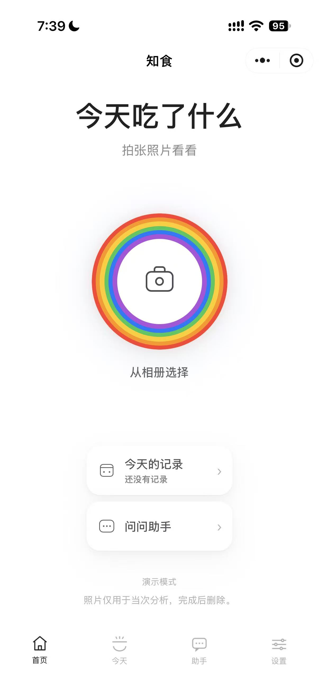
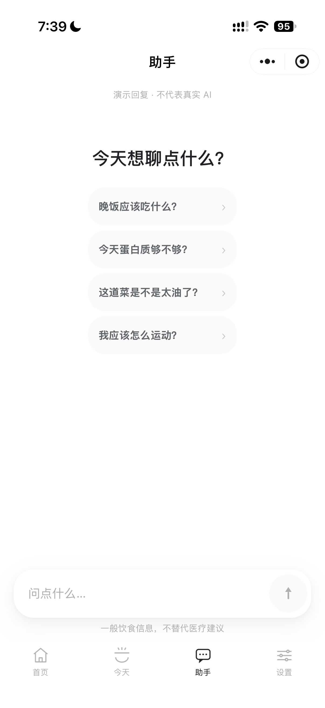

# 知食 · 家庭 AI 营养助手

知食是一款原生微信小程序：用户拍下饭菜照片，AI 先识别食物与份量，服务端再用精选食物成分数据计算营养区间，最后给出温和、可执行的下一餐建议，并支持语音朗读与简单追问。

产品面向普通中国家庭，尤其是中老年成员和营养知识有限的用户。它不提供医疗诊断，不承诺减重或治病，也不会把照片估算包装成精确测量。

## 界面预览

<p align="center">
  
  &nbsp;&nbsp;&nbsp;
  
</p>

## 当前状态

- M001–M004 的代码已实现，面向微信开发者工具的本地演示模式已交付；但本机未安装开发者工具，因此“可编译运行”尚未实际验证。
- 已通过：TypeScript 类型检查、云函数打包、82 个自动化测试。
- 未验证：微信开发者工具编译与模拟器/真机 UI、真实 CloudBase 环境、真实 DeepSeek 视觉调用、腾讯云 TTS。
- 当前环境没有安装微信开发者工具，也没有 CloudBase 环境或腾讯云 TTS 凭据；未进行任何付费云部署，也未发起真实 AI/TTS 计费调用。
- 未提交微信审核，也没有任何“官方审核通过”的声明。

## 主要能力

- 拍照/相册选图，客户端压缩与大小校验
- 上传票据 + 文件路径双重校验
- DeepSeek `deepseek-flash` 多模态识别，仅输出食物、份量、做法和油盐风险级别
- 服务端营养区间计算，不采信模型生成的营养数值
- 未收录食物的同类回退与透明说明
- 营养结果、油盐提示、下一餐建议、活动建议、免责声明
- 腾讯云 TTS 普通话朗读，懒加载、播放/暂停、重播、0.85×/1×/1.15× 语速
- AI 聊天与预设问题；仅在用户明确授权后参考最近三天饮食摘要
- 今日记录、份量/食物纠正、单条删除、全部数据删除
- 本地演示模式：无任何凭据也可完整走通拍照、结果、聊天、设置
- 演示数据强制标记，绝不冒充真实 AI 输出
- 相机/相册调用前读取微信隐私授权状态，未授权时显示自定义隐私说明与同意按钮

## 快速开始（本地演示）

前置：Node.js ≥ 20，微信开发者工具（需另行安装）。

```bash
cd /Users/chadrayfoo/Projects/family-nutrition-assistant
npm install
npm run check
```

打开微信开发者工具，选择“导入项目”，目录选择本仓库根目录：

- AppID：可使用测试号或 `touristappid`
- 小程序根目录：`miniprogram/`（`project.config.json` 已配置）
- 确认设置中启用了 TypeScript 编译插件
- `miniprogram/config.ts` 中 `CLOUD_ENV_ID` 保持空字符串时，自动使用本地演示模式
- 无需配置 DeepSeek Key、CloudBase 或 TTS 即可体验完整流程

注意：本地演示结果固定为示例餐次，会显示“演示模式/演示数据”标记，不代表对照片的真实识别。

## 切换到云端真实模式

1. 按 [DEPLOYMENT.md](DEPLOYMENT.md) 创建 CloudBase 环境、集合、索引与安全规则。
2. 执行 `npm run build:cloud`，在开发者工具中上传并部署 `cloudfunctions/api`。
3. 在云函数环境变量中配置 DeepSeek 与腾讯云 TTS 凭据（不要写入小程序端）。
4. 将 `miniprogram/config.ts` 的 `CLOUD_ENV_ID` 改成真实环境 ID。
5. 将 `project.config.json` 的 `appid` 换成你的小程序 AppID。
6. 在开发者工具中重新编译，先在设置页的“运行与性能诊断”中确认 AI/TTS 状态。

## 目录结构

```text
miniprogram/                 原生小程序（WXML / WXSS / TypeScript）
  pages/                     首页、拍照、结果、助手、今天、设置、纠正
  components/                餐次卡、语音播放器、空状态、卡片、演示标识、聊天气泡
  services/                  CloudApi / LocalMockApi 边界
  types/                     前后端共享契约
  utils/                     图片、存储、格式化、错误、性能诊断
cloudfunctions/api/          单入口云函数（TypeScript 源 + esbuild 产物）
  src/domain/                识别校验、食物库、营养计算、建议生成
  src/providers/             DeepSeek、腾讯 TTS、演示 AI
  src/repositories/          CloudBase 数据与存储适配
  src/handlers/              上传、分析、聊天、语音、资料、维护
tests/                       Vitest 自动化测试
scripts/                     云函数构建、Tab 图标生成
docs/                        补充数据来源与发布检查清单
```

## 工程文档

- [ARCHITECTURE.md](ARCHITECTURE.md)
- [PRODUCT_REQUIREMENTS.md](PRODUCT_REQUIREMENTS.md)
- [DEVELOPMENT.md](DEVELOPMENT.md)
- [DEPLOYMENT.md](DEPLOYMENT.md)
- [TESTING.md](TESTING.md)
- [SECURITY.md](SECURITY.md)
- [AGENTS.md](AGENTS.md)

## 配置与密钥

服务端变量见 [.env.example](.env.example)，包括：

- `DEEPSEEK_API_KEY`、`DEEPSEEK_BASE_URL`、`DEEPSEEK_MODEL`
- `TENCENTCLOUD_SECRET_ID`、`TENCENTCLOUD_SECRET_KEY`、`TTS_VOICE_TYPE`
- 每日配额、超时、图片大小、图片删除策略
- `MAINTENANCE_SECRET`（仅维护接口使用）

小程序端没有 API Key 配置项。DeepSeek 与 TTS 密钥必须只存在于云函数环境变量中。

## 校验命令

```bash
npm run typecheck       # 小程序 + 云函数 TypeScript
npm test                # Vitest，82 个用例
npm run build:cloud     # 打包 cloudfunctions/api/index.js
npm run check           # 上述全部
```

当前测试结果：`10 passed (10) / 82 passed (82)`。

## 已知限制

- 营养数据是区间化估算，不能用于医疗、疾病管理或精确营养处方。
- 当前精选数据覆盖常见家常菜，并未覆盖全部中餐；未命中时按同类食物回退，并明确提示。
- 照片无法测量盐含量，也无法准确换算实际用油量。
- 真实 DeepSeek 视觉、CloudBase、TTS 尚未进行联调；需要按部署文档自行验证。
- 未安装微信开发者工具，因此没有执行模拟器/真机 UI 自动化。
- 图片默认分析后立即删除；未完成分析的上传依赖票据过期与维护清理。
- 发布前仍需完成微信隐私保护指引、用户协议、数据合规与真机测试。

## 安全与医疗边界

- 本产品只提供一般饮食信息，不提供诊断、治疗、药物或极端饮食建议。
- 遇到疾病、用药、孕期、儿童或明显不适，应建议咨询医生或注册营养师。
- 不得将演示模式输出宣传为真实识别结果。
- 不得把用户数据用于跨用户缓存、训练或分析。

## 数据来源

食物成分数据是面向常见中式饮食的少量精选估算区间，参考：

- 中国营养学会《中国居民膳食指南（2022）》
- 中国疾病预防控制中心营养与健康所《中国食物成分表（标准版·第6版）》的常见量级
- USDA FoodData Central（公共领域）交叉核对

该精选数据集按 CC BY 4.0 提供，具体范围、限制与署名说明见 [ARCHITECTURE.md](ARCHITECTURE.md) 和 `cloudfunctions/api/src/data/food-database.json`。代码本身未声明开源许可证，如需开源请由项目所有者决定。

## 外部参考

- DeepSeek API 文档：<https://api-docs.deepseek.com/>
- DeepSeek Vision 指南：<https://api-docs.deepseek.com/guides/vision/>
- 腾讯云基础语音合成：<https://cloud.tencent.com/document/api/1073/37995>
- 微信云开发文档：<https://developers.weixin.qq.com/miniprogram/dev/wxcloud/basis/getting-started.html>
